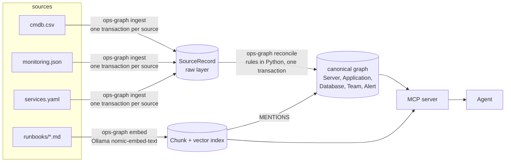
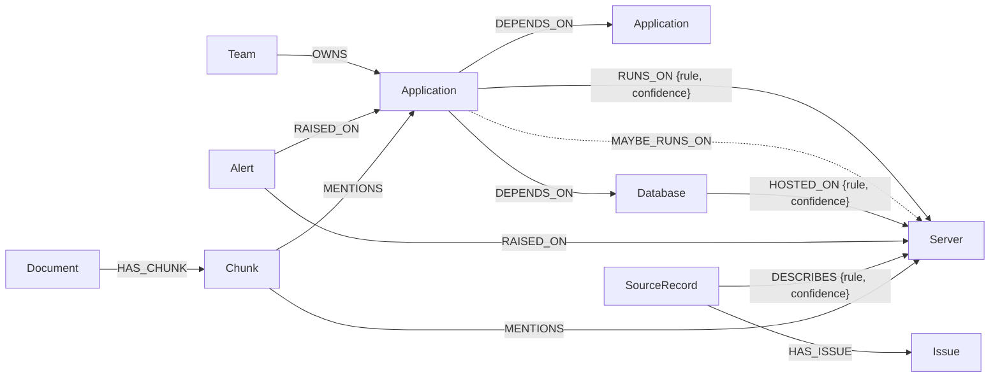

# ops-graph

An Ops knowledge graph for AI agents. Three inventory sources that disagree with each
other (a CMDB export, a monitoring export, a hand-edited service catalog) are ingested
into Neo4j, reconciled into one graph with full provenance, and exposed to an agent
through an MCP server: impact analysis, root cause, decommissioning, compliance, and
GraphRAG over runbooks with a local embedding model.

All data is fictional ("Acme Mutual", a made-up insurer). It is small on purpose and
seeded with the problems real inventories have: the same server spelled four ways,
a typo, an ambiguous host name, a server nobody registered, a retired server that
is still running.

## Quick start

```bash
docker compose up -d                  # Neo4j + one-shot loader: ingest, reconcile, embed
docker compose logs loader            # what the loader did
```

Neo4j Browser: http://localhost:7474 (user `neo4j`, password `ops-graph-demo`, change it
in `.env`). Runbook embedding needs [Ollama](https://ollama.com) on the host with
`ollama pull nomic-embed-text`; without it the loader skips that step and every graph
tool still works.

Without Docker for the Python side (Python 3.11 and [uv](https://docs.astral.sh/uv/)):

```bash
docker compose up -d neo4j
uv run ops-graph run                  # ingest + reconcile + embed
uv run ops-graph serve                # MCP server on stdio
```

Behind a TLS-intercepting proxy or antivirus, the container cannot download packages
(`invalid peer certificate: UnknownIssuer`); use the `uv run` path, or add your proxy's
root certificate to the image.

## Use it from an agent

`.mcp.json` declares the server for Claude Code and other MCP clients. Open the project,
accept the `ops-graph` server, and ask:

- *Why is customer-portal slow?*
- *What breaks if we stop db01 tonight?*
- *Which servers can we decommission?*
- *Where do we keep personal data on unsupported systems?*
- *What does the runbook say about replication lag, and is it happening now?*

| Tool | Answers |
|---|---|
| `find_asset` | "db01.par", "SRV-PAR-DB01", "claims-api" to an entity id |
| `impact_analysis` | everything that stops if an asset stops, with the path that proves it |
| `root_cause_candidates` | alerting dependencies, most likely cause first |
| `decommission_candidates` | servers with no live workload, with reasons; unknown workload is `blocked`, never a candidate |
| `compliance_findings` | personal data on an unsupported OS or on an unregistered server |
| `reconciliation_report` | what reconciliation could not settle, and how every link was made |
| `search_docs` | GraphRAG: runbook passages plus the live alerts and dependencies of what they mention |
| `describe_schema` | counts and direction conventions |
| `read_only_cypher` | anything else, read-only and guarded (see below) |

Every tool is declared read-only. Names are resolved for the agent; an ambiguous name
("app01" exists in Paris and Lyon) is refused with the candidates, so the agent asks
instead of guessing. Answers carry `confidence`, `needs_review` and `uncertain` flags
from reconciliation, so a deduction is never presented as a fact.

## How it works



**Stage 1, ingest.** Each source row becomes a `SourceRecord` node holding the raw row,
a content hash and its batch id. One source is one transaction: records missing from the
new batch are marked `stale`, and if anything fails the whole batch rolls back, so a
half-read file can never make servers disappear.

**Stage 2, reconcile.** Live records are read back from Neo4j, matched in plain Python
(`reconcile.build_plan`, unit-tested without a database), and the derived graph is
replaced in one transaction. Because it reads the graph, not the files, reconciliation
can be replayed alone after a rule change. Order matters: CMDB servers first (the CI id
is the master identity), then monitoring hosts (an unknown host becomes a shadow server
`UNREG-<site>/<host>`), then catalog services, placed on CMDB and shadow servers alike.

### Matching rules

Every host spelling goes through one grammar (`normalize.py`): `SRV-PAR-APP02`,
`app-02.par.acme.local` and `srv-par-app02` all become `(app, 2, par)`. Rules are tried
from strongest to weakest evidence; the first rule with exactly one candidate wins, and a
rule with several candidates stops and reports an ambiguity.

| Rule | Evidence | Confidence | Review |
|---|---|---|---|
| `ip_exact` | same IP address | 1.0 | no |
| `name_site` | same stem, number and site | 0.9 | no |
| `name_unique` | site unknown, exactly one server fits | 0.8 | no |
| `fuzzy_stem` | same site and number, letters 80% similar ("bacth01") | 0.6 | yes |
| `ambiguous` | several servers fit: one `MAYBE_RUNS_ON` edge per candidate | 0 | yes |
| `unresolved` | nothing fits: reported | 0 | yes |

The fuzzy rule never compares numbers: "web01" and "web11" are 89% similar as strings
and are different machines. Confidences are ordinal levels, not calibrated probabilities.

### Graph model



Dependency edges always point from the thing that needs to the thing it needs. Impact
and root cause are then the same traversal read in opposite directions. Details in
[docs/model.md](docs/model.md).

## Example Cypher

What stops if db01 stops, and through which path:

```cypher
MATCH (target:Server {host_key: 'par/db01'})
MATCH p = (impacted:Asset)-[:DEPENDS_ON|RUNS_ON|HOSTED_ON|MAYBE_RUNS_ON*1..6]->(target)
RETURN impacted.name, min(length(p)) AS distance
ORDER BY distance
```

Root cause: alerting things below customer-portal, deepest first (nothing below them alerts):

```cypher
MATCH p = (:Application {name: 'customer-portal'})-[:DEPENDS_ON|RUNS_ON|HOSTED_ON*0..6]->(suspect)
WHERE EXISTS { (:Alert)-[:RAISED_ON]->(suspect) }
WITH suspect, min(length(p)) AS distance
RETURN suspect.name, distance,
       NOT EXISTS {
         MATCH (suspect)-[:DEPENDS_ON|RUNS_ON|HOSTED_ON*1..6]->(deeper)
         WHERE EXISTS { (:Alert)-[:RAISED_ON]->(deeper) }
       } AS deepest
ORDER BY deepest DESC, distance DESC
```

Where does this server come from, and which rule linked each source:

```cypher
MATCH (r:SourceRecord)-[d:DESCRIBES]->(s:Server {id: 'CI00202'})
RETURN r.source, r.source_key, d.rule, d.confidence
```

## Demo script

```bash
uv run ops-graph run                          # day 1
```

1. Ask *why is customer-portal slow?* `root_cause_candidates` ranks `SRV-PAR-DB01` first
   (replication lag, disk at 92%) through `customer-portal → claims-api → claims-db`,
   ahead of `claims-api` whose errors are an echo.
2. Ask *what does the runbook say?* `search_docs` returns the db01 replication-lag passage
   with db01's two live alerts attached.
3. Ask *what is wrong in our inventory?* `reconciliation_report`: mq01 is not in the CMDB,
   fraud-scoring's host "app01" is ambiguous, billing-batch was matched on a typo.

```bash
uv run ops-graph ingest --data data/day2      # day 2: the CMDB registers mq01
uv run ops-graph reconcile
```

4. Ask *what depends on mq01?* The answer now lands on the CMDB id `CI00801`, the shadow
   node is gone, its alert and the runbook that mentions it followed.

This scenario is also the end-to-end test (`tests/test_e2e_mcp.py`), run through an MCP client.

## Free Cypher, guarded

An agent that writes its own Cypher reads untrusted text (alert messages, documents), so
`read_only_cypher` stacks five layers, each with a test:

1. read transaction: Neo4j itself refuses writes;
2. denylist: `LOAD CSV`, `CALL dbms.*`, `apoc.*`, `IN TRANSACTIONS`, checked after removing
   comments while keeping string literals (a probe showed `LOAD CSV` runs inside a read
   transaction, so layer 1 alone would let the database fetch URLs);
3. 5-second transaction timeout;
4. 200-row cap, extra rows never pulled from the server;
5. server setting: no `LOAD CSV` from local files.

A denylist is not a security boundary on its own; Neo4j Community has no role-based
access control. With Enterprise, the agent would get a read-only database user.

## Tests

```bash
docker compose --profile test up -d neo4j-test   # throwaway database on port 7688
uv run pytest                                    # unit + integration
uv run pytest -m "not integration"               # no database needed
```

Integration tests never touch the demo database. GraphRAG tests use a deterministic
bag-of-words embedder (`HashingEmbedder`), so they run without Ollama; one test checks the
real model when it is installed.

## Scope and limits

- Built as a demonstration in a few days, at a scale of tens of entities. Full rebuild of
  the derived graph per reconciliation is simple and always correct here; at a large
  scale it would become a per-source incremental rebuild.
- Matching is deterministic on purpose: reproducible, testable, auditable. An LLM would
  fit as an arbiter of the review queue, not as the first matcher.
- Root-cause ranking is an explainable heuristic, not causal inference.
- Stack: Neo4j 5.26 Community, Python 3.11, official MCP Python SDK 2.x (`MCPServer`,
  formerly FastMCP), neo4j-graphrag, Ollama, rapidfuzz.

## License

MIT, see [LICENSE](LICENSE).
