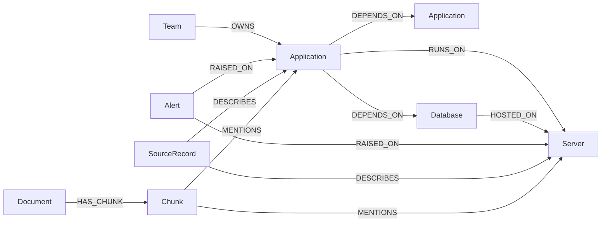

# Graph model

## Nodes

| Label | Key | Comes from | Notes |
|---|---|---|---|
| `Server` (+`Asset`) | `id` = CMDB `ci_id`, or `UNREG-<key>` | CMDB, monitoring, catalog | `in_cmdb=false` when only monitoring knows it (shadow IT) |
| `Application` (+`Asset`) | `id` = `app:<name>` | catalog | `criticality`, `personal_data`, `status` |
| `Database` (+`Asset`) | `id` = `db:<name>` | catalog | `engine`, `personal_data` |
| `Team` | `id` | catalog, CMDB support group | |
| `Alert` | `id` | monitoring | `severity`, `message`, `raised_at` |
| `SourceRecord` | `(source, source_key)` | every source | one node per raw row: the provenance trail |
| `Document`, `Chunk` | `path`, `id` | runbooks (GraphRAG) | `Chunk.embedding` sits in a vector index |

`Asset` is a shared label on everything an operator can name ("db01", "claims-api"),
so one index answers "find this thing" regardless of its type.

`Entity` is carried by every canonical node (servers, applications, databases, teams,
alerts) with one uniqueness constraint on `id`: reconciliation upserts and deletes
through that single key. Raw-layer nodes are not entities:

| Label | Key | Role |
|---|---|---|
| `SourceRecord` | `(source, source_key)` | raw row as JSON `payload`, `hash`, `batch`, `stale` |
| `Batch` | `(source, id)` | one published import of one source, `completed_at`, `as_of` |
| `Issue` | (none) | review item hanging off a record: `ambiguous_host`, `not_in_cmdb`, `unresolved_host`... |

## Two stages

1. `ops-graph ingest` writes `SourceRecord`s only, one transaction per source. Records of
   that source missing from the batch become `stale`. A failed import rolls back whole.
2. `ops-graph reconcile` reads the live records back, matches them in Python
   (`reconcile.build_plan`), and replaces every derived node and relationship in one
   transaction. An entity no live record describes is deleted.

## Relationships

Arrows point from the thing that needs to the thing it needs.

```
(Application)-[:DEPENDS_ON]->(Application|Database)
(Application)-[:RUNS_ON {rule, confidence, needs_review}]->(Server)
(Application)-[:MAYBE_RUNS_ON {rule: 'ambiguous'}]->(Server)   one per candidate
(Database)-[:HOSTED_ON {rule, confidence, needs_review}]->(Server)
(Team)-[:OWNS]->(Application|Database)
(Team)-[:SUPPORTS]->(Server)
(Alert)-[:RAISED_ON]->(Server|Application)
(SourceRecord)-[:DESCRIBES {rule, confidence, needs_review}]->(Entity)
(SourceRecord)-[:HAS_ISSUE]->(Issue)
(Document)-[:HAS_CHUNK]->(Chunk)-[:MENTIONS]->(Asset)
```

With one direction for every dependency edge, the two core questions become
the same traversal read both ways:

- **Impact** of stopping X: everything that has a path *to* X.
- **Root cause** for a failing X: everything X has a path *to*, filtered on alerts.


